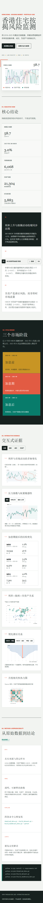

# Data Analytics Portfolio

A collection of reproducible data-analysis projects covering database design, product analytics, customer behavior, risk monitoring, metric governance and decision-oriented visual communication.

## Projects

| Project | Analytical Focus | Key Evidence |
| --- | --- | --- |
| [Restaurant Ordering and Operational Analytics](restaurant-analytics-platform/README.md) | Transaction systems, product analysis, repeat behavior, refunds and hourly demand | MySQL schema, SQL views, transaction tests, scale tests and UCI real-data validation |
| [Hong Kong Mortgage Risk Monitor](#hong-kong-mortgage-risk-monitor) | Mortgage market cycles, composite risk measurement and lead-lag analysis | Reproducible data pipeline, bilingual dashboard, sensitivity analysis and limitations |

## Featured Project 1: Restaurant Analytics

[Visual portfolio showcase](https://yuehaomin-svg.github.io/Data-Analytics-Portfolio/restaurant-analytics-platform/) · [Project documentation](restaurant-analytics-platform/README.md) · [Metric dictionary](restaurant-analytics-platform/docs/metrics.md) · [Real-data validation](restaurant-analytics-platform/docs/real-data-validation.md)

The repository includes `streamlit_app.py`, a dynamic presentation layer for Streamlit Community Cloud backed by a reproducible SQLite snapshot of 1,000 synthetic orders.

This project combines a restaurant ordering system with operational analytics. It models the full transaction lifecycle in MySQL, converts orders and refunds into consistent metrics, and tests the same analytical framework on 1.07 million real retail transaction lines.

Portfolio evidence includes a normalized database schema, meaningful SQL analysis views, transaction and concurrency tests, 1K/10K/50K scale experiments, index and `EXPLAIN` analysis, product/customer/time analysis, and a documented boundary between synthetic system data and external method validation.

---

# Hong Kong Mortgage Risk Monitor

### Data analysis portfolio project on interest rates, mortgage activity and housing risk


[Open the interactive dashboard](https://yuehaomin-svg.github.io/Data-Analytics-Portfolio/dashboard/) · [Chinese report](docs/report-cn.md) · [English report](docs/report-en.md) · [Methodology](docs/methodology.md)

> GitHub Pages is not enabled automatically. Follow the steps below once before sharing the interactive dashboard link.

## Project Overview

This project examines how the Hong Kong interest-rate hiking cycle coincided with changes in residential mortgage demand, approvals, transactions and negative-equity risk from January 2018 to December 2025.

It combines a reproducible Python data pipeline, mixed-frequency exploratory analysis, a transparent composite stress index and a bilingual interactive dashboard. The presentation focuses on analytical evidence, business interpretation and visual communication.

## Key Findings

- Mortgage applications fell **25.3%** during the hiking window, while approvals declined **17.8%** and residential transactions declined **24.3%**.
- The composite mortgage stress index peaked at **58.7/100 in July 2024**; alternative weighting schemes produced peaks of 58.7–60.7, supporting the timing result.
- Three-month HIBOR and mortgage applications moved in opposite directions, with a descriptive correlation of **-0.70**.
- Applications and residential transactions were most closely related at zero lag (**r = 0.67**), indicating a largely synchronous market cycle rather than a stable one-way lead.
- Negative equity appeared later: HIBOR led the strongest negative-equity relationship by **12 months (r = 0.85)**, although common trends and quarterly sampling limit causal interpretation.

## Portfolio Highlights

| Analytical focus | What the dashboard shows |
| --- | --- |
| Market cycle segmentation | Pre-hiking, hiking and post-hiking comparisons |
| Composite risk measurement | Stress-index construction and three weighting scenarios |
| Relationship analysis | Correlation heatmap and lead-lag diagnostics |
| Business translation | Executive KPI cards, structured findings and limitations |
| Communication | Responsive Chinese-English interface and reproducible documentation |

<details>
<summary><strong>Mobile dashboard preview</strong></summary>



</details>

## Data Sources

| Domain | Official source | Frequency |
| --- | --- | --- |
| Mortgage applications, approvals and LTV | HKMA Residential Mortgage Survey | Monthly |
| Negative equity | HKMA Mortgage Loans in Negative Equity Survey | Quarterly |
| Interest rates | HKMA Hong Kong Dollar Interest Settlement Rates | Monthly average |
| Residential transactions | Hong Kong Land Registry | Monthly |
| Unemployment | Census and Statistics Department | Rolling three-month |
| Inflation | Census and Statistics Department | Monthly year-on-year |

## Analytical Workflow

1. Download fixed snapshots from official open-data sources.
2. Harmonise monthly, rolling-quarterly and quarterly observations.
3. Build application, approval, transaction, rate, negative-equity and macroeconomic indicators.
4. Calculate a four-component mortgage stress index and test alternative weights.
5. Run descriptive correlation and lead-lag analysis with explicit limitations.
6. Publish the evidence through an interactive bilingual dashboard.

## Reproduce the Project

```powershell
python -m venv .venv
.\.venv\Scripts\Activate.ps1
python -m pip install -r requirements.txt

python scripts/download_data.py
python scripts/build_dataset.py
python scripts/build_dashboard_data.py
python -m pytest -q
```

Open `dashboard/index.html` directly, or serve the repository locally:

```powershell
python -m http.server 8000
```

Then visit `http://127.0.0.1:8000/dashboard/`.

## Repository Structure

```text
dashboard/             interactive bilingual dashboard
artifacts/             desktop and mobile dashboard previews
data/raw/              official source snapshots, excluded from Git
data/processed/        generated analysis datasets, excluded from Git
docs/                  reports, methodology, data dictionary and portfolio notes
scripts/               data download and reproducible transformation pipeline
tests/                 pipeline and visual regression checks
```


## Important Limitations

- The stress index is a relative monitoring gauge, not a credit-risk probability or investment signal.
- Monthly observations provide a limited sample for statistical inference.
- Negative-equity data is quarterly and common time trends may inflate correlation estimates.
- Approvals divided by applications is a market-level proxy, not a cohort-level approval probability.
- Correlation and lead-lag results are descriptive and should not be interpreted as causal estimates.

## About This Portfolio Version

This academic team project is presented as a data-analysis portfolio case study. The public dashboard intentionally omits personal member details. When using the project in a job application, add a short and truthful statement of your own contribution.

For interview preparation, see [portfolio-notes.md](docs/portfolio-notes.md).
